<div align="center">

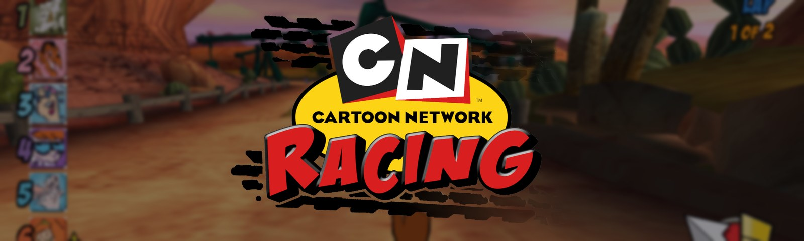

### Cartoon Network Racing on PC, running natively, in widescreen and at high frame rates, from your own PlayStation 2 disc.

[](https://github.com/TekRantGaming/cartoon-network-racing-recompiled/releases/latest)
&nbsp;
[](https://discord.gg/8eakYSvBZS)

[](https://github.com/TekRantGaming/cartoon-network-racing-recompiled/releases/latest)
[](https://github.com/TekRantGaming/cartoon-network-racing-recompiled/releases)


<br>

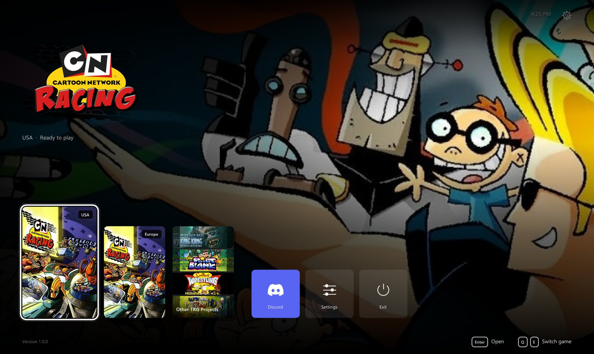

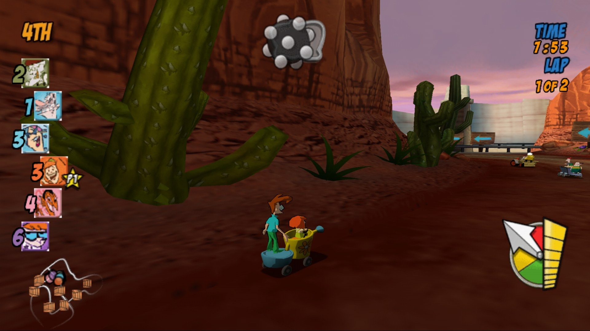
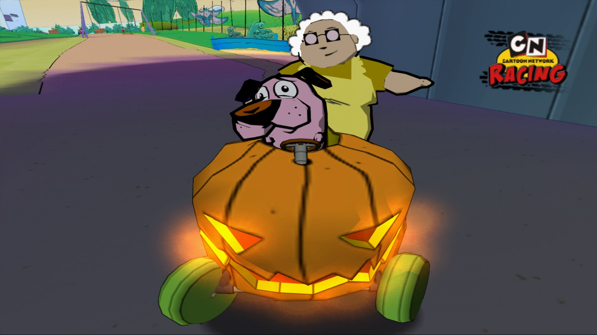
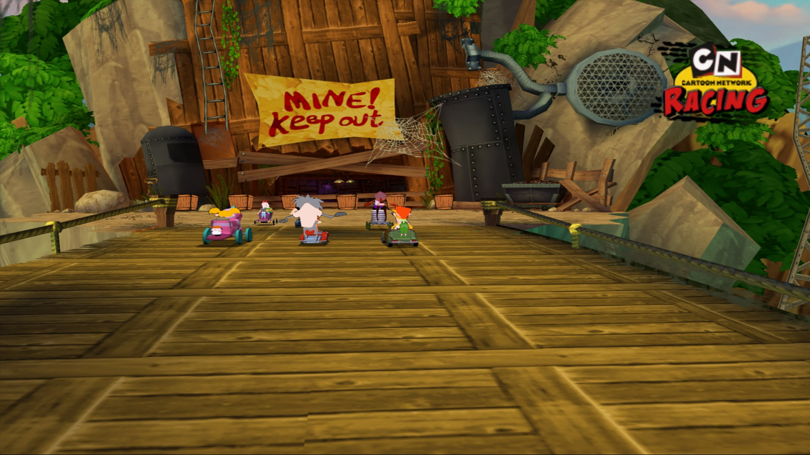

<sub>The original PlayStation 2 game code, translated to native PC code with <a href="https://github.com/ran-j/PS2Recomp">PS2Recomp</a>. <b>No game files included</b>: bring your own disc image.</sub>

</div>

<br>

## At a glance

| | | |
| :--- | :--- | :--- |
| 💿 **Install from your own disc**, found on your PC by itself | 🌍 **USA and European discs**, each with its own version | 🖥️ **Up to 4K**, with the picture drawn at the size you choose |
| 🏁 **True 16:9** that shows more of the track, and 4:3 if you prefer | ⚡ **Up to 165 frames a second**, with the game at its normal speed | ✨ **FXAA, SMAA**, sharpening, TV filters and colour controls |
| 🎮 **Any controller** with button remapping and vibration | ⌨️ **Keyboard** with your own keys | ↩️ **Back to the launcher** any time: hold Back + Start, or Esc |
| 💾 **Saves beside the game**, with backups and restore in one click | 🛋️ **A console style dashboard**, made for a controller | 🪟 **Borderless fullscreen**, windowed, any monitor |
| 🔄 **Updates itself**, and keeps your saves and settings | 🚂 **Add to Steam** with its own artwork | 💬 **[Join the Discord](https://discord.gg/8eakYSvBZS)** right from Home |

## The game

<div align="center">

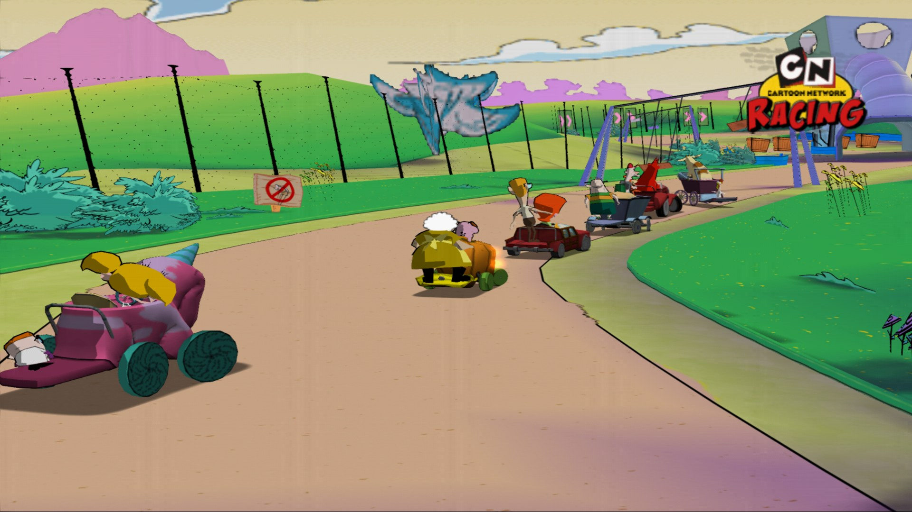
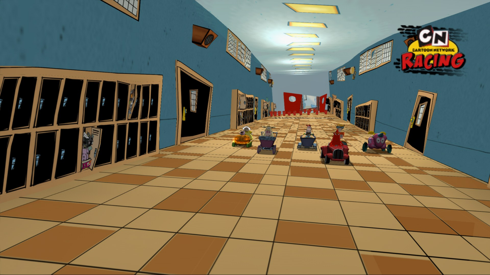
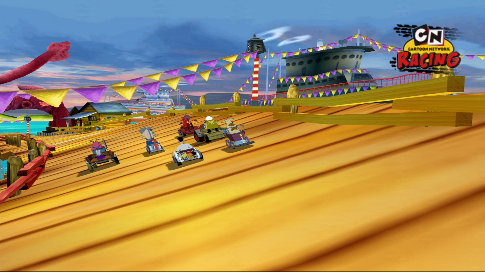
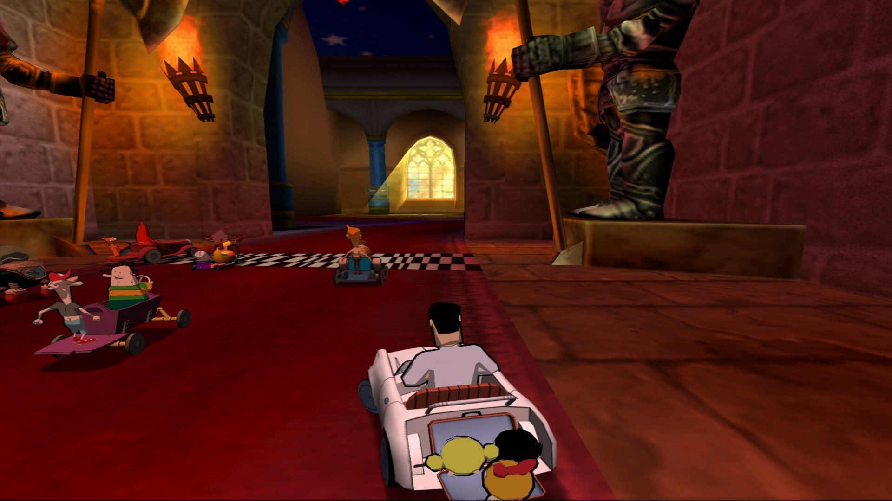
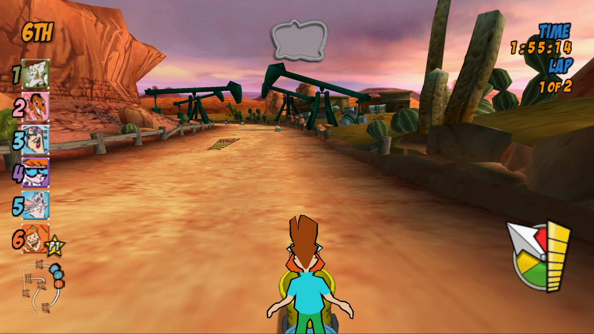
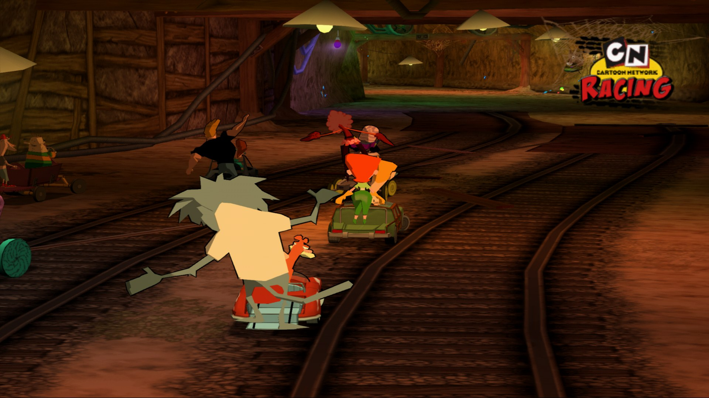

<sub><b>Race the Cartoon Network stars.</b> A kart racer from 2006, with a driver and co-driver in every kart.</sub>

</div>

<br>

## Getting started

**You need:** Windows 10 or 11 (64 bit), a processor with AVX2, a graphics card with Direct3D 11, and a disc image you made from your own USA or European disc (see [Which discs work](#which-discs-work)).

1. Download **CartoonNetworkRacing-...-windows-x64.zip** from the [latest release](https://github.com/TekRantGaming/cartoon-network-racing-recompiled/releases/latest) and unzip it anywhere. It holds the launcher and both versions of the game, and everything stays in that folder, so it's portable.
2. Run **cnr_launcher.exe**. It opens in fullscreen on Home. Windows may warn about an unknown publisher the first time: choose **More info**, then **Run anyway**.
3. Pick your region and press **Play**. The first time, the launcher asks for your disc image: it finds disc images on your PC by itself (or choose the file), checks that it is the right disc and sets the game up.
4. Press **Play** again, and from then on it starts straight away.

While you play, **hold Back and Start** on the controller, or **hold Esc**, to come back to the launcher. **No game files are included**: they come from your own disc. The launcher keeps your image as `games\<region>\game\disc.iso`. When the image is on the same drive this is a link to it, so it takes no extra space and stays even if you move or delete the original. Your saves are kept in `games\cnr_usa\saves` and `games\cnr_eu\saves`.

### Which discs work

Only the disc ID is checked, so any good dump of these discs works. These are the images the port was made and tested with:

| Region | Disc ID | Version | Disc image | SHA1 | Installed |
| --- | --- | --- | --- | --- | --- |
| USA | `SLUS_214.38` | 1.01 | 3,674,963,968 bytes | `C842BFCB98E68F8D453A6D48BBDC8E6A3E35F3EC` | about 3.7 GB |
| Europe | `SLES_543.06` | 1.00 | 3,672,604,672 bytes | `34696933D56D9D4FF4659AC1875470FE748CA069` | about 3.7 GB |

The launcher's install screen shows every detail for each disc, MD5 and CRC32 too. To check a disc image yourself, run this in PowerShell and compare the result with the SHA1 above:

```powershell
Get-FileHash "C:\Games\Cartoon Network Racing (USA).iso" -Algorithm SHA1
```

## The launcher

Everything is set up before the game starts, with a controller, the keyboard or the mouse. The USA and European versions each have their own page and settings. It is the [TRG Launcher](https://github.com/TekRantGaming/trg-launcher), shared by the TekRantGaming ports.

<table>
<tr>
<td width="55%"></td>
<td valign="middle">

### Home
- **Both regions** side by side, labelled USA and Europe
- Each one shows at a glance whether it's **ready to play**
- **Other TRG Projects**, **Discord** and **Settings**
- **Add to Steam**: adds the game to your Steam library with its own artwork. Steam closes for a moment while it's added and opens again afterwards
- Plays with a **controller**, the **keyboard** or the **mouse**, with interface sounds

</td>
</tr>
<tr>
<td valign="middle">

### Game page
- **Play**, the only place the game starts
- **Settings** and **Saves and install**
- Your **save backups** and details of your copy

</td>
<td width="55%">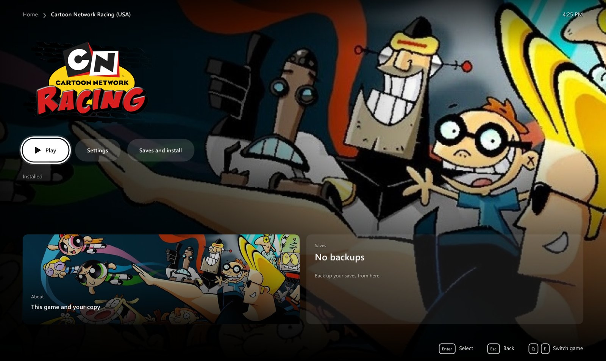</td>
</tr>
<tr>
<td>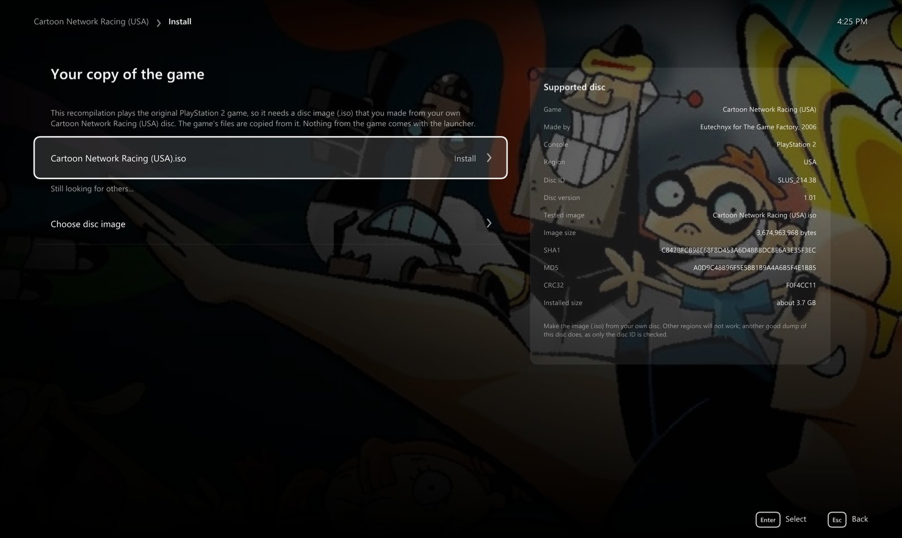</td>
<td valign="middle">

### Install from your own disc
- The launcher **finds disc images** on your PC by itself, or you **choose the file**
- A card shows **exactly which disc works**: disc ID, version, size, SHA1, MD5 and CRC32
- It checks the disc really is this game and this region, and tells you if it isn't

</td>
</tr>
<tr>
<td valign="middle">

### Display
- **Fullscreen** or **windowed**, on **any monitor**
- **Resolution**: your screen, 720p, 1080p, 1440p or 4K. The game draws at that size, not just the window
- **Frame rate**: 60 (the default), 90, 120, 144 or 165 on the USA disc; 50 (the default), 60, 90 or 120 on the European disc. The game still runs at the right speed
- **16:9** that shows more of the track, or the original **4:3**
- The race display at the screen edges, or in the middle
- **Vertical sync** and a **frame rate counter**

</td>
<td width="55%">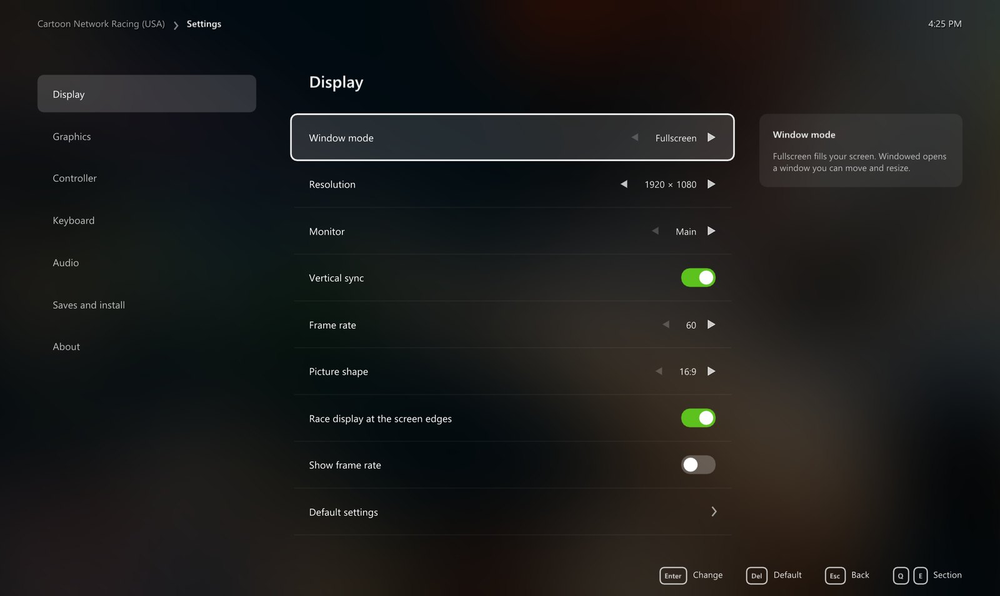</td>
</tr>
<tr>
<td>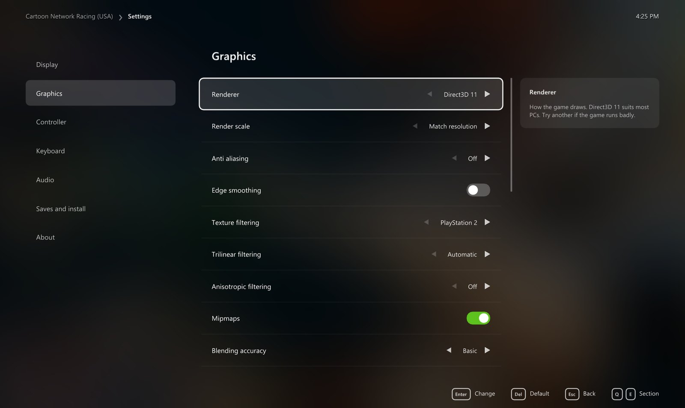</td>
<td valign="middle">

### Graphics
- **Direct3D 11**, **Direct3D 12** or **Vulkan**
- **Render scale** from the original picture up to 8x
- **FXAA**, **SMAA** (Direct3D 11) and the PlayStation 2's own edge smoothing
- **Anisotropic filtering** up to 16x, plus texture and trilinear filtering
- **Sharpening**, **TV filters**, **brightness, contrast, saturation and gamma**
- **Blending accuracy**, dithering and mipmaps
- **Replacement textures**: load your own, or save the game's as a start

</td>
</tr>
<tr>
<td valign="middle">

### Controller and keyboard
- **Remap any button** on your controller
- **Stick deadzone** and **vibration** strength
- **Your own keys** for every PlayStation 2 button

</td>
<td width="55%">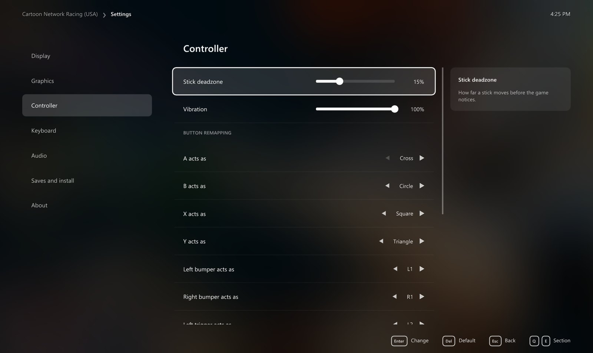</td>
</tr>
<tr>
<td>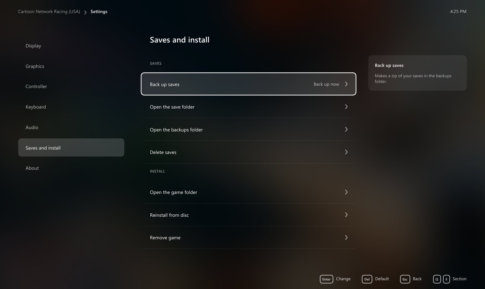</td>
<td valign="middle">

### Saves and install
- **Back up** your saves to a zip and **restore** them in one click
- Open the save, backup and game folders
- **Reinstall** from your disc, or **remove** the game. Your saves stay

</td>
</tr>
</table>

### Updates

When the launcher opens it checks GitHub for new versions of itself and of each game and **installs them by themselves**, restarting into a new launcher once nothing else is going on. Your disc, saves and settings stay as they are. Turn that off in the launcher's own **Settings**.

## PlayStation 2 vs PC

| | PlayStation 2 | PC |
| --- | :---: | :---: |
| Resolution | standard definition | up to 4K, drawn at up to 8x |
| Picture shape | 4:3 | 16:9 that shows more of the track, or 4:3 |
| Frame rate | up to 60 (Europe 50) | up to 165 (Europe up to 120) |
| Anti aliasing | console | FXAA or SMAA |
| Texture filtering | console | up to 16x anisotropic |
| Display | TV | borderless fullscreen or windowed, any monitor, TV filters if you miss it |
| Controls | DualShock 2 | any controller, remapping, keyboard |
| Saves | memory card | files beside the game, with backups |

## Good to know

### Hotkeys and default keys

| Key | Action |
| --- | --- |
| Hold <kbd>Back</kbd> + <kbd>Start</kbd>, or hold <kbd>Esc</kbd> | back to the launcher while playing |
| <kbd>F11</kbd> | the launcher fullscreen or windowed |
| Arrow keys | steer and move through menus |
| <kbd>Enter</kbd> / <kbd>Backspace</kbd> | Start / Select |
| <kbd>Z</kbd> <kbd>X</kbd> <kbd>C</kbd> <kbd>V</kbd> | Cross, Square, Circle, Triangle |
| <kbd>Q</kbd> <kbd>E</kbd> / <kbd>1</kbd> <kbd>3</kbd> | L1, R1 / L2, R2 |

### Known issues

- **Rare freeze on a Loading screen.** Now and then the game stays on a Loading screen. Hold Back + Start, or Esc, and start it again.
- In 16:9, markers floating over the track (such as an opponent's tag) sit slightly off their target.
- At high frame rates the minimap fades in faster than it should.
- SMAA works with Direct3D 11 only.
- Windows only for now.

### Reporting a problem

Please open an [issue](https://github.com/TekRantGaming/cartoon-network-racing-recompiled/issues) with your region, what happened, your CPU, graphics card and the resolution and frame rate you play at, or ask on the [Discord](https://discord.gg/8eakYSvBZS). When the launcher starts the game, its log is in `games\<region>\logs`.

## About the game

*Cartoon Network Racing* was developed by Eutechnyx for the PlayStation 2 and published by The Game Factory in 2006. Until now the only way to play this version was on a console or an emulator. This port runs it natively on Windows and adds the options you would expect from a PC release.

<details>
<summary><b>Building from source (for developers)</b></summary>

See [docs/BUILDING.md](docs/BUILDING.md). The game code is generated from each disc's own program file, so building needs your own disc too. Nothing generated from the game is ever committed here, and the source code holds no game code or assets. [docs/FINDINGS.md](docs/FINDINGS.md) has the reverse engineering notes behind each fix.

</details>

## Credits

- **Cartoon Network Racing** by Eutechnyx, published by The Game Factory in 2006.
- [**PS2Recomp**](https://github.com/ran-j/PS2Recomp), which does the code translation and runs the game, and [**KillzoneRecomp**](https://github.com/drakolordx7/KillzoneRecomp), whose fork of it and libraries for PCSX2's renderer, sound and vector units this port is built on.
- [**PCSX2**](https://github.com/PCSX2/pcsx2) for the graphics, sound and vector unit code, and [**pcsx2_patches**](https://github.com/PCSX2/pcsx2_patches) (widescreen patches by Arapapa), which pointed the way to the 16:9 camera.
- [**Ghidra**](https://github.com/NationalSecurityAgency/ghidra) with [**ghidra-emotionengine-reloaded**](https://github.com/chaoticgd/ghidra-emotionengine-reloaded) for the analysis.
- [**SDL**](https://www.libsdl.org), [**Dear ImGui**](https://github.com/ocornut/imgui) and [**stb**](https://github.com/nothings/stb).
- [**SMAA**](https://github.com/iryoku/smaa) by Jorge Jimenez and others.
- The [**TRG Launcher**](https://github.com/TekRantGaming/trg-launcher).
- Game artwork in the launcher from [**SteamGridDB**](https://www.steamgriddb.com), downloaded when the launcher runs.

## Licence

The code here is under the [GNU General Public License 3.0](LICENSE), as it builds on PCSX2, PS2Recomp and KillzoneRecomp. The TRG Launcher is MIT licensed and SMAA has its own licence in `ext/kzgs`.

> [!NOTE]
> **AI disclosure:** this port was made almost entirely with Claude Code (Anthropic). The repository owner directed and tested the work; the AI did the analysis, code, tools and documentation.

> [!IMPORTANT]
> This project is not affiliated with or endorsed by Cartoon Network, Warner Bros. Discovery, Eutechnyx, The Game Factory or Sony. All trademarks belong to their owners. The source code here contains no game code or assets. A release contains no original game files or assets either: its programs hold the game's code translated for PC, and everything else comes from your own disc. Do not open issues asking for game files.
